<!-- ═══════════════ HEADER ═══════════════ -->
<div align="center">




<a href="https://github.com/nived1277">
  
</a>

<br/>

<a href="https://www.linkedin.com/in/nivedsunil/"></a>
<a href="mailto:nivedsunil03@gmail.com"></a>
<a href="https://github.com/nived1277?tab=repositories"></a>


</div>

<br/>

<!-- ═══════════════ WHOAMI ═══════════════ -->
## `~/whoami`

```bash
$ cat nived.json
```

```json
{
  "name": "Nived Sunil",
  "degree": "B.Tech CSE (AI & ML) — Sree Buddha College of Engineering",
  "focus": ["Web Development", "AI / ML", "Data Engineering"],
  "building": "practical apps with modern web tech, AI and data",
  "learning": ["Advanced React", "Generative AI", "FastAPI", "System Design"],
  "published": "Research paper, Scopus indexed",
  "status": "Build • Learn • Create • Improve"
}
```

<br/>

<!-- ═══════════════ STACK ═══════════════ -->
## `~/stack`

<div align="center">

<table>
<tr>
<td align="center" width="170"><b>Languages</b></td>
<td>

</td>
</tr>
<tr>
<td align="center"><b>Web</b></td>
<td>

</td>
</tr>
<tr>
<td align="center"><b>AI / ML</b></td>
<td>

<sub>&nbsp;CNN · LSTM · YOLOv8 · Computer Vision</sub>
</td>
</tr>
<tr>
<td align="center"><b>Maps</b></td>
<td><sub>Leaflet · OpenStreetMap · Overpass API</sub></td>
</tr>
<tr>
<td align="center"><b>Tools</b></td>
<td>

</td>
</tr>
</table>

</div>

<br/>

<!-- ═══════════════ PROJECTS ═══════════════ -->
## `~/projects`

<table>
<tr>
<td width="50%" valign="top">

### 🍽️ Ruchi Kootu
Discover nearby restaurants on an interactive, location-based map.

<sub>


</sub>

[**View repo →**](https://github.com/nived1277/Ruchi-Kootu)

</td>
<td width="50%" valign="top">

### 🔧 Unified Predictive Maintenance
AI + IoT system estimating machine health and Remaining Useful Life across industrial, automotive and aerospace use cases.

<sub>


</sub>

</td>
</tr>
<tr>
<td width="50%" valign="top">

### 🤖 FutureMe AI
A personalized, AI-assisted web experience built with a React frontend and FastAPI backend.

<sub>


</sub>

</td>
<td width="50%" valign="top">

### 🩺 AI Medical Diagnosis Assistance
Deep learning exploration of AI-assisted medical image analysis with CNNs.

<sub>


</sub>

</td>
</tr>
</table>

<br/>

<!-- ═══════════════ CREDENTIALS ═══════════════ -->
## `~/credentials`

- 🎓 **B.Tech** — Computer Science & Engineering (AI & ML)
- 📄 **Research publication** — Scopus indexed
- 🤖 AI & Robotics Training
- 🌐 Full Stack Web Development with AI Tools
- 🚀 Next Gen Employability Program
- 📚 NPTEL Coursework / Certification

<br/>

<!-- ═══════════════ STATS ═══════════════ -->
## `~/activity`

<div align="center">


<br/><br/>


<br/>


</div>

<br/>

<!-- ═══════════════ FOOTER ═══════════════ -->
<div align="center">

<i>"Build • Learn • Create • Improve"</i>


</div>
